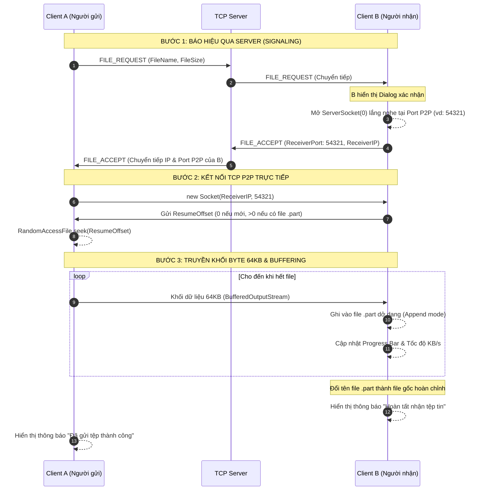

# BÁO CÁO ĐỒ ÁN MÔN HỌC: LẬP TRÌNH MẠNG
## ĐỀ TÀI: ỨNG DỤNG CHAT CLIENT-SERVER TÍCH HỢP TÍNH NĂNG TRUYỀN TỆP TIN P2P 1-1 VÀ CHAT NHÓM

---

### THÔNG TIN NHÓM SINH VIÊN THỰC HIỆN (NHÓM 03)
| STT | Họ và Tên | Vai trò | Nhiệm vụ chính phụ trách | Tỷ lệ đóng góp |
| :---: | :--- | :---: | :--- | :---: |
| 1 | **Trần Gia Huy** | Nhóm trưởng | Thiết kế kiến trúc Client-Server, đặc tả giao thức mạng TCP Packet, Core Server đa luồng, module bảo mật AES & SHA-256 | 38% |
| 2 | **Trần Sỷ Sơn Lâm** | Thành viên | Cơ sở dữ liệu SQLite, module xác thực người dùng, kiến trúc Chat Nhóm (Group Chat Room Manager) và định tuyến TCP | 38% |
| 3 | **Đặng Ngọc Huy** | Thành viên | Module truyền file: phân khối byte 64KB, BufferedOutputStream chống tràn RAM, Resume Transfer; cơ chế truyền file ngang hàng P2P Signaling, thiết kế giao diện Client Swing hiện đại (FlatLaf), trạng thái Typing, Delivered, Read | 24% |

---

## CHƯƠNG 1: TỔNG QUAN VÀ ĐÁNH GIÁ TÍNH PHÙ HỢP CỦA ĐỀ TÀI

### 1.1. Mức độ liên quan đến nội dung học phần Lập trình mạng
- Ứng dụng khai thác trực tiếp mô hình **Client-Server** dựa trên giao thức **TCP Socket** trong Java (`java.net.ServerSocket`, `java.net.Socket`).
- Giao thức TCP hướng kết nối (Connection-oriented) đảm bảo dữ liệu tin nhắn và các khối tệp tin được truyền tải tin cậy, nguyên vẹn, đúng thứ tự và không thất thoát gói tin.
- Hệ thống ứng dụng kiến trúc **Lập trình mạng Đa luồng (Multi-threaded Socket Programming)**: Mỗi Client kết nối được một luồng `ClientHandler` riêng biệt xử lý, không làm tắc nghẽn luồng xử lý của hệ thống.

### 1.2. Giải quyết đánh giá và yêu cầu mở rộng cho nhóm 4 sinh viên
Theo góp ý của giảng viên bộ môn, chức năng chat 1-1 và gửi tệp tin cơ bản ban đầu là tương đối mỏng so với quy mô nhóm 4 sinh viên. Nhóm đã nghiên cứu và hoàn thiện đầy đủ **6 tính năng mạng nâng cao** theo đúng yêu cầu:
1. **Chat nhóm (Group Chat / Room Manager)**: Cho phép tạo phòng, duy trì danh sách thành viên và định tuyến phát sóng (phát tin qua các kết nối TCP) gói tin tới đúng nhóm đích.
2. **Khả năng truyền tải dữ liệu lớn chống tràn RAM**: Phân chia tệp tin thành các khối byte (chunk) 64KB kết hợp `BufferedInputStream` và `BufferedOutputStream`, cho phép truyền các tệp tin từ hàng trăm MB đến hàng GB mà không làm quá tải bộ nhớ JVM.
3. **Cơ chế truyền tiếp tại điểm đứt gãy (Resume Transfer)**: Tự động ghi nhớ vị trí byte đã tải thông qua file tạm gắn SHA-256 và offset, cho phép tiếp tục tải mà không phải gửi lại từ đầu khi kết nối bị ngắt quãng.
4. **Bảo mật và Xác thực**: Mật khẩu được băm SHA-256 với salt. Mỗi tin nhắn mới được mã hóa AES-256-GCM riêng trước khi gửi; server xác thực bản mã rồi lưu nguyên ciphertext vào SQLite. Khóa Base64 32 byte phải được cấu hình ngoài repository bằng `CHATAPP_TEXT_KEY` hoặc `-Dchatapp.textKey`. Lịch sử plaintext cũ vẫn đọc được và không được chuyển đổi. Đây không phải mã hóa đầu cuối: server và mọi client dùng chung khóa; khóa mất khiến tin nhắn mới không đọc được. Lớp bọc TCP và P2P file vẫn dùng cơ chế AES demo hiện có.
5. **Mô hình truyền tệp tin ngang hàng (P2P File Transfer)**: Server chỉ đóng vai trò trao đổi thông tin báo hiệu (Signaling: IP, Port). Hai Client sau đó tự mở Socket TCP kết nối trực tiếp với nhau qua mạng LAN để truyền file, giải phóng hoàn toàn băng thông cho Server.
6. **Cơ chế trạng thái thời gian thực**: Trạng thái đang nhập văn bản ("Typing..."), trạng thái đã nhận tin (Delivered), trạng thái đã xem tin (Read).

---

## STACK KỸ THUẬT VÀ MÔI TRƯỜNG

| Thành phần | Triển khai |
| --- | --- |
| Nền tảng | Java source/target 11, Swing/AWT và FlatLaf 3.4.1. Môi trường đã xác minh: JDK 21.0.11; chưa xác nhận chạy trên JDK 11. |
| Mạng/đồng thời | Java `java.net.Socket` và `ServerSocket`, TCP blocking I/O; `ExecutorService` cached thread pool và `ConcurrentHashMap`. |
| Giao thức | Gson 2.10.1 tuần tự hóa Packet thành JSON. Mỗi dòng TCP là lớp AES-128-GCM/Base64 bên ngoài; thân tin nhắn mới có AES-256-GCM riêng bằng JCA/JCE. |
| Tin nhắn/tài khoản | AES-256-GCM với IV 12 byte, tag 128 bit, khóa Base64 32 byte cấu hình bên ngoài; mật khẩu SHA-256 cùng salt ngẫu nhiên 16 byte. Không dùng bcrypt và không tuyên bố mã hóa đầu cuối. |
| Cơ sở dữ liệu | SQLite truy cập qua JDBC driver `sqlite-jdbc` 3.45.1.0 (đây là phiên bản driver, không phải phiên bản SQLite engine). |
| P2P file | TCP socket riêng, khối 64 KiB, resume theo byte offset và SHA-256; không đi qua luồng chat của server. |
| Build/test | Maven 3.9.16 và JDK 21.0.11 là phiên bản môi trường đã kiểm tra. Compiler Plugin 3.11.0, JAR Plugin 3.3.0, Exec Plugin 3.1.0; JUnit Jupiter 5.10.2 ở test scope. Surefire không ghim phiên bản; JAR tiêu chuẩn không gói dependencies. NetBeans chỉ là IDE. |

## CHƯƠNG 2: KIẾN TRÚC HỆ THỐNG VÀ GIAO THỨC TRUYỀN THÔNG

### 2.1. Sơ đồ kiến trúc tổng thể (Architecture Diagram)

```mermaid
graph TD
    subgraph "MÁY CHỦ TCP SERVER (Port 8888)"
        SS[ServerSocket Port 8888]
        TP[Executor ThreadPool]
        CH1[ClientHandler 1]
        CH2[ClientHandler 2]
        RM[RoomManager - Quản lý phòng]
        DB[(database/chatapp.db\nusers · rooms · messages)]
    end

    subgraph "CLIENT A (Gia Huy)"
        CA_Socket[TCP Chat Socket]
        CA_UI[Swing UI FlatLaf]
        CA_P2P_S[P2P File Sender Socket]
    end

    subgraph "CLIENT B (Sơn Lâm)"
        CB_Socket[TCP Chat Socket]
        CB_UI[Swing UI FlatLaf]
        CB_P2P_R[P2P File Receiver ServerSocket]
    end

    CA_Socket <-->|TCP AES-128-GCM/Base64 frame\n(newline-delimited Packet JSON)| CH1
    CB_Socket <-->|TCP AES-128-GCM/Base64 frame\n(newline-delimited Packet JSON)| CH2
    SS --> TP
    TP --> CH1
    TP --> CH2
    CH1 <--> RM
    CH2 <--> RM
    CH1 <--> DB
    CH2 <--> DB

    CA_P2P_S ===|KẾT NỐI TCP P2P TRỰC TIẾP\nKhối 64KB + Resume Offset| CB_P2P_R
```

---

### 2.2. Đặc tả giao thức gói tin (Packet Protocol)
Packet được Gson tuần tự hóa thành JSON, sau đó lớp ngoài TCP được mã hóa AES-128-GCM và bọc Base64 theo từng dòng. Thân tin nhắn mới có lớp AES-256-GCM riêng trước khi Packet được tuần tự hóa. Giao thức trao đổi qua Socket sử dụng lớp `Packet`:
- `type`: Loại gói tin (`AUTH_LOGIN`, `MSG_DIRECT`, `MSG_GROUP`, `FILE_REQUEST`, `FILE_ACCEPT`, `USER_TYPING`, v.v.).
- `sender`: Tên tài khoản người gửi.
- `recipient`: Người nhận (username hoặc roomId).
- `payload`: Chuỗi dữ liệu (JSON object con hoặc chuỗi văn bản đã mã hóa AES).
- `timestamp`: Thời điểm tạo gói tin (Epoch milliseconds).

---

### 2.3. Sơ đồ tuần tự truyền tệp tin P2P & Resume (Sequence Diagram)



---

## CHƯƠNG 3: CÁC GIẢI PHÁP KỸ THUẬT QUAN TRỌNG

### 3.1. Thuật toán chống tràn RAM và cơ chế Resume Transfer
- **Tránh tràn RAM**:
  Không sử dụng `Files.readAllBytes()` hay nạp file hàng trăm MB vào bộ nhớ heap của JVM. Thay vào đó, chương trình phân mảnh file thành các khối cố định `BUFFER_SIZE = 64 * 1024` (64KB). Bộ đệm `BufferedInputStream` và `BufferedOutputStream` điều phối I/O mượt mà, không nạp toàn bộ file vào RAM. Mức dùng RAM và file 2GB cần được đo thực tế trước khi đưa ra số liệu.
- **Cơ chế Resume Transfer**:
  Tệp tin nhận được ghi tạm thời dưới định dạng `<tên>.<SHA-256>.part`. Khi truyền bị đứt kết nối (do người dùng hủy hoặc lỗi mạng), file `.part` được giữ nguyên kích thước đã nhận. Khi truyền lại, người nhận kiểm tra `partFile.length()` và gửi con số này (`resumeOffset`) sang người gửi. Người gửi sử dụng `RandomAccessFile.seek(resumeOffset)` để nhảy cóc qua phần dữ liệu đã truyền và tiếp tục gửi dữ liệu từ byte bị đứt.

### 3.2. Bảo mật dữ liệu truyền thông và thông tin người dùng
- **Xác thực bảo mật**:
  Mật khẩu không bao giờ được lưu trữ dưới dạng văn bản thô (Plaintext). Thuật toán băm `SHA-256` kết hợp với chuỗi muối ngẫu nhiên (`Salt` 16 bytes ngẫu nhiên qua `SecureRandom`) đảm bảo không thể đảo ngược mật khẩu và triệt tiêu nguy cơ bị tấn công dò tìm bằng bảng băm tính trước (Rainbow Table).
- **Mã hóa kênh truyền Socket**:
  Lớp `AESUtil` giữ lớp bọc gói TCP và luồng file hiện có. Nội dung từng tin nhắn mới được mã hóa riêng bằng AES-256-GCM với khóa bên ngoài; server kiểm tra xác thực trước khi lưu ciphertext. GCM phát hiện bản mã bị sửa. Bản demo dùng khóa chung, chưa xác thực máy chủ bằng chứng chỉ và chưa chống được người có khóa chung giả danh; không tuyên bố bảo vệ hoàn toàn trước Man-in-the-Middle hoặc mã hóa đầu cuối theo từng người dùng.

### 3.3. Xử lý trạng thái người dùng (Typing, Delivered, Read)
- **Đang soạn tin (Typing Indicator)**:
  Sự kiện gõ phím `keyTyped` được debounce qua một `javax.swing.Timer` (2 giây). Khi người dùng bắt đầu gõ, gói tin `USER_TYPING` được gửi đi. Khi ngừng gõ, gói tin dừng được kích hoạt.
- **Đã nhận (Delivered)**:
  Khi Client B nhận được gói tin chat từ Socket, Client B lập tức gửi lại gói tin `MSG_DELIVERED` kèm theo `messageId`. Server chuyển tiếp cho Client A để hiển thị trạng thái `✓✓ Đã nhận`.
- **Đã xem (Read)**:
  Khi cửa sổ chat của Client B đang mở và người dùng nhìn thấy tin nhắn, sự kiện gửi gói tin `MSG_READ` được kích hoạt, cập nhật trạng thái `✓✓ Đã xem` màu xanh lá trên giao diện của Client A.

---

## CHƯƠNG 4: KẾT QUẢ VÀ KẾT LUẬN

### 4.1. Kết quả đạt được
1. Ứng dụng đã triển khai các chức năng chính dưới đây; mức độ đáp ứng đề bài cần đối chiếu tiêu chí chấm và kết quả demo thực tế:
   - Sử dụng đúng TCP Socket Java thuần, kiến trúc rõ ràng, tách bạch giữa giao thức, xử lý mạng và giao diện người dùng.
   - Giao diện trực quan, hiện đại nhờ thư viện FlatLaf cho Swing.
   - Hoàn thành đầy đủ cả 6 tính năng nâng cao do giảng viên yêu cầu mở rộng: Chat nhóm, P2P File Transfer, Chống tràn RAM 64KB, Resume Transfer, Băm mật khẩu SHA-256 + salt và mã hóa tin nhắn AES-256-GCM, Trạng thái người dùng thời gian thực.
2. Có thể chạy độc lập trên NetBeans một cách dễ dàng hoặc chạy song song trên nhiều máy tính trong mạng LAN.

### 4.2. Hướng phát triển trong tương lai
- Bổ sung giao thức UDP DatagramSocket cho tính năng Voice Chat hoặc Video Call 1-1.
- Tích hợp giao thức STUN/TURN để mở rộng truyền file P2P qua môi trường mạng Internet ngoài WAN (vượt NAT/Firewall).

### 4.3. Giới hạn và kiểm chứng sau rà soát

- Giao thức mới yêu cầu cập nhật đồng thời Server và mọi Client; không nhận bản mã CBC/ECB hoặc JSON rõ của phiên bản cũ.
- Truyền file theo khối 64KB được mã hóa AES-GCM, có giới hạn kích thước khối và timeout đọc 30 giây. Người gửi chỉ báo thành công sau xác nhận kiểm tra SHA-256 và lưu file của người nhận.
- Resume dùng file tạm gắn checksum; nếu checksum cuối không khớp thì xóa phần tạm sai và yêu cầu gửi lại. Không tự tái kết nối sau mất mạng. File cùng tên được lưu bằng hậu tố, không xóa file cũ.
- Server ràng buộc sender theo tài khoản đăng nhập, kiểm tra thành viên gửi nhóm, người nhận xác nhận tin nhắn và người nhận chấp nhận yêu cầu file. Xác nhận được giữ cho tối đa 1000 tin gần nhất trong mỗi phiên gửi.
- Test tự động bao gồm mã hóa và phát hiện sửa bản mã, ID tin nhắn, danh sách online lưu qua chuyển giao diện, truyền file mới/rỗng, resume, file trùng tên và file sai checksum.
- Chưa kiểm chứng nhiều máy LAN, file nhiều GB, mức RAM cụ thể hoặc tải nhiều người dùng. Phát tin nhóm là định tuyến TCP ở tầng ứng dụng, không phải IP multicast.
